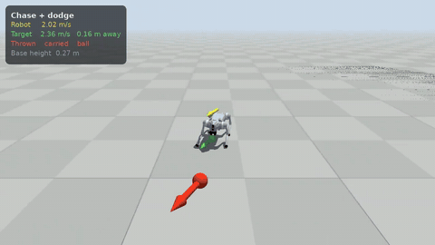
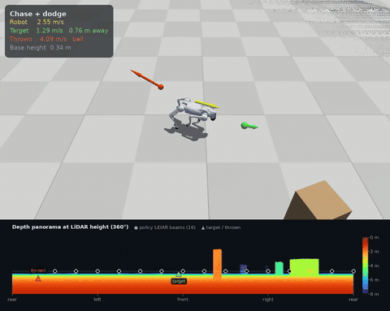
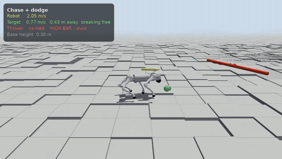

# Go2-SuperMimic: Agile Chasing and Dodging on a Unitree Go2

[](LICENSE)
[](https://www.python.org/)
[](https://github.com/mujocolab/mjlab)

Ziyue Zheng, Johns Hopkins University

Simulation tasks and training code for a Unitree Go2 that **chases** a fleeing ball while
**dodging** balls and bars thrown at it, on flat ground, among obstacles and on rough terrain.
Training is model-based: our re-implementation of
[SuperMimic](https://arxiv.org/abs/2610.28480) (a learned world model plus back-propagation
through imagined rollouts) on [mjlab](https://github.com/mujocolab/mjlab) (MuJoCo Warp).

## 📖 Overview

| Flat | Obstacles | Terrain |
|:---:|:---:|:---:|
|  |  |  |
| `Go2-Chase-Flat` | `Go2-Chase-Obstacles` | `Go2-Chase-Terrain` |

Every task combines the same two games:

- **Chase.** The green ball flees at about the robot's speed, jukes sideways and stays in an
  arena. Touching it with the head is a *tag*; the ball then breaks free and runs again.
- **Dodge.** Obstacles are thrown from around the chase ball, one at a time and with no
  wind-up: high, mid and low **balls** (duck, sidestep, lift a leg), **low bars** to jump over
  and **high bars** to duck under.

| Task | Scene | Extra robot input | Episode modes | Thrown |
|---|---|---|---|---|
| `Go2-Chase-Flat` | open flat ground | – | chase / dodge / both (30 / 30 / 40 %) | balls + bars |
| `Go2-Chase-Obstacles` | tall boxes, pillars and walls, placed per episode | 16-ray planar LiDAR | chase / dodge / both (30 / 30 / 40 %) | balls + bars (slower) |
| `Go2-Chase-Terrain` | pyramid stairs up and down, box grids, rough ground, slopes; 5 difficulty rows | 11 × 7 height scan | chase / chase + dodge (60 / 40 %) | bars |

Among obstacles the chase ball slides along them and throws wait for a clear line to the robot.
On terrain, steps grow from 2 to 10 cm and box edges from 2 to 8 cm; harder rows open during
training.

## 🚀 Quickstart

```bash
pip install -e .        # needs mjlab >= 1.6 (MuJoCo Warp, CUDA GPU)
python -m pytest tests  # generator, collision model, obstacles, height scan, warm starts

# Watch the pretrained policies.
python scripts/eval.py Go2-Chase-Flat --checkpoint weights/flat.pt --mode both \
    --num-envs 1 --seconds 30 --video flat.mp4
python scripts/eval.py Go2-Chase-Obstacles --checkpoint weights/obstacles.pt --mode both \
    --num-envs 1 --seconds 30 --video obstacles.mp4
python scripts/eval.py Go2-Chase-Terrain --checkpoint weights/terrain.pt --terrain stairs \
    --num-envs 1 --seconds 30 --video terrain.mp4
```

### Pretrained policies

`weights/` holds the actor of each task (policy only; enough for `scripts/eval.py`, not for
resuming training, which also needs the world model and critic).

| file | task | inputs |
|---|---|---|
| `flat.pt` | `Go2-Chase-Flat` | 350 |
| `obstacles.pt` | `Go2-Chase-Obstacles` | 430 |
| `terrain.pt` | `Go2-Chase-Terrain` | 735 |

### Train

```bash
# Flat ground, from scratch (see "How the released policies were trained" on length).
python scripts/train.py --task Go2-Chase-Flat --run-name flat
# Extend a run: resume it and carry on its iteration count, curricula and schedules.
python scripts/train.py --task Go2-Chase-Flat --resume logs/supermimic/<flat>/model_12000.pt \
    --continue-run true --iterations 30000 --run-name flat_cont

# Obstacles, warm-started from the flat policy (its new LiDAR inputs start at zero weight).
python scripts/train.py --task Go2-Chase-Obstacles --resume logs/supermimic/<flat>/model_12000.pt \
    --run-name obstacles

# Terrain, warm-started from the flat policy (new height-scan inputs start at zero weight).
# Two drivers keep collecting world-model data throughout (they shape the data only; the
# trained and deployed policy is the actor alone): a terrain-walking policy (steady steps on
# edges and slopes) and the flat policy itself (jumps and ducks on terrain).
# Terrain rows and ball speed ramp up over 12k iterations.
python scripts/train.py --task Go2-Chase-Terrain --resume logs/supermimic/<flat>/model_12000.pt \
    --driver-policy <MoE-CTS policy.pt> --driver-frac 0.1 \
    --expert-policy logs/supermimic/<flat>/model_12000.pt --expert-frac 0.1 \
    --wm-updates 4 --actor-lr-scale 0.3 --warmup-iterations 1000 --run-name terrain
```

The terrain-walking driver is go2_rl_lab's mixed-terrain MoE-CTS policy (MIT), not included
here: download `exported/policy.pt` from
[wty-yy/go2_rl_gym_data](https://huggingface.co/wty-yy/go2_rl_gym_data/tree/main/go2_rl_lab/2026-10-13_15-35-09_mixed1.3.2resume_82.5k_0.6929).

Every field of `TrainCfg` (`go2_supermimic/supermimic/train.py`) is a command-line flag. On a
16 GB GPU use `--num-envs 2048 --imag-batch 4096 --buffer-len 400` for terrain.

### How the released policies were trained

All three were trained from scratch with SuperMimic in this setup, with no demonstrations and
no PPO; only the terrain runs used other policies, and only to collect world-model data.

- **Flat** (`flat.pt`): tens of thousands of iterations in total, in stages that each
  resumed the previous checkpoint while the task grew: chasing only, then thrown balls, then
  bars, then throws from around the chase ball. It was trained with an earlier version of
  this code; the released task is the final stage (checked against it config by config and
  by evaluation). A single run of the final task from scratch is still being checked: after
  ~7k iterations it chases and rarely falls, but it is still hit by bars far more often, so
  expect to need longer runs (or the staged route) to match `flat.pt`.
- **Obstacles** (`obstacles.pt`): resumed from the flat policy, about 8k iterations.
- **Terrain** (`terrain.pt`): resumed from the flat policy; about 12k iterations on gentler,
  continuous terrain, then about 25k on the current terrain across several restarts while
  fixing problems (a higher fall penalty, bars that come from uphill, a finer height map,
  keeping the data drivers on, a lower actor learning rate); the last 12k ran with the
  command above. Earlier stages used other settings, so this is the setup we ended with, not
  a single run we have reproduced end to end.

### Evaluate and record

```bash
# Metrics over many envs at the hardest settings: tags / min, per-kind dodge hit rates with
# body height, top foot and sideways speed, obstacle contact, falls / min, speed.
python scripts/eval.py Go2-Chase-Flat --checkpoint model.pt --num-envs 256 --seconds 60

# A video of env 0 with a status card (mode, robot and ball speeds).
python scripts/eval.py Go2-Chase-Obstacles --checkpoint model.pt --mode both \
    --num-envs 1 --seconds 30 --video obstacles.mp4
python scripts/eval.py Go2-Chase-Terrain --checkpoint model.pt --terrain stairs \
    --num-envs 1 --seconds 30 --video stairs.mp4
```

`--mode chase|dodge|both|mixed` overrides the task's episode modes; `--terrain` puts env 0 on
one terrain type (`flat`, `stairs`, `stairs_inv`, `boxes`, `rough`, `slope`, `slope_inv`).

## 🔌 Interfaces

**Policy.** `Actor` (`go2_supermimic/supermimic/train.py`): an MLP from the stacked actor
observation to 12 joint-position actions (target = default pose + action × per-joint scale, PD
control at 50 Hz). Checkpoints hold `actor`, `critic`, `world_model` and the training config.

**Actor observation**, 5 frames of history, each term stacked oldest → newest:

| term | per frame | notes |
|---|---|---|
| base angular velocity | 3 | IMU, body frame |
| projected gravity | 3 | body frame |
| joint positions − default | 12 | with a per-episode encoder bias |
| joint velocities | 12 | |
| last action | 12 | |
| target | 28 | the two slots below |
| LiDAR | 16 | obstacles task only; ranges to 4 m |
| height scan | 77 | terrain task only; base height above an 11 × 7 grid, 12 cm spacing |

Total: 350 (flat), 430 (obstacles), 735 (terrain) inputs. No linear velocity: it is not
measured on the robot.

**Target observation** (`go2_supermimic/target/interface.py`), the only thing the policy knows
about the balls: two slots, CHASE then DODGE, in the robot yaw frame. In simulation they are
filled from ground truth (`oracle_observation`); on the robot a perception stack must fill the
same layout.

| per slot (14) | meaning |
|---|---|
| `p` (3), `v` (3) | object position relative to the base and its velocity, yaw frame |
| `sigma` (3) | 1-σ position uncertainty (0 for the oracle) |
| `visible`, `age` | measured this step; seconds since the last measurement |
| `is_bar`, `half_len` | bar or ball; bar half length |
| `active` | the object is in play (an inactive slot is all zeros) |

## 📦 Package layout

```
go2_supermimic/
  robot/        go2.py (actuators, collisions), go2.xml + meshes (MuJoCo Menagerie)
  target/       generator.py   chase ball and dodge obstacles (pure `advance`, shared with imagination)
                collision.py   trunk box + leg capsules, hit clearance, tag and dodge reward helpers
                interface.py   the two-slot target observation
                obstacles.py   static obstacles: layout, 2D geometry, LiDAR, line of sight
                terrain.py     height field and the local height scan (terrain + obstacles)
  env/          env_cfg.py     the three tasks
                command.py     target command term (balls, hits, curricula, debug drawing)
                mdp.py         observation, reward and curriculum terms
                terrains.py    terrain mix and scene look
  supermimic/   world_model.py, buffer.py, imagine.py (analytic rewards, soft survival),
                train.py (collect / fit world model / improve policy), driver.py (terrain data)
  viz.py        video look and status card
scripts/        train.py, eval.py
tests/          no simulator needed
weights/        pretrained policies (actor only)
resources/      demo GIFs
```

## ⚠️ Limitations

- Simulation only. Nothing here has run on a physical Go2 yet.
- Perception is ground truth: the target slots are filled from the simulator. On the robot
  they must come from a detector; simulated sensor noise and dropouts
  are not part of the released tasks.
- Terrain is harder than flat ground: with all rows (steps up to 10 cm) and the fastest ball,
  `weights/terrain.pt` falls about 0.6 times a minute and is hit by about one in ten low bars;
  on the easier rows about 0.3 falls a minute. Training continues.
- The training recipes have not each been reproduced end to end from scratch (see "How the
  released policies were trained").

## 📚 Citation

This repository re-implements the training method of SuperMimic; please cite the paper:

```bibtex
@article{liao2026supermimic,
  title   = {SuperMimic: Scaling Humanoid Whole-Body Control with One Differentiable World Model},
  author  = {Liao, Qiayuan and Shao, Yiyang and Long, Junfeng and Zakka, Kevin and
             Horowitz, Roberto and Abbeel, Pieter and Sreenath, Koushil},
  journal = {arXiv preprint arXiv:2610.28480},
  year    = {2026}
}
```

## 🙏 Acknowledgements

- [SuperMimic](https://supermimic.github.io) (Liao et al., 2026) for the training method.
- [mjlab](https://github.com/mujocolab/mjlab) and MuJoCo Warp for simulation.
- [MuJoCo Menagerie](https://github.com/google-deepmind/mujoco_menagerie) for the Go2 model.
- [go2_rl_lab](https://github.com/wty-yy/go2_rl_gym) (MoE-CTS, Tianyang Wu) for the terrain
  policy used to collect world-model data.
- [SPIKE Lab](https://spike-lab.org) at Johns Hopkins University for its support.
- [Claude Code](https://www.anthropic.com/claude-code) (Anthropic), which helped write and
  debug much of this code.

## 📄 License

MIT (see [LICENSE](LICENSE)). The Go2 model and meshes in `go2_supermimic/robot/` come from
MuJoCo Menagerie and keep their own license
([LICENSE_menagerie_go2](go2_supermimic/robot/LICENSE_menagerie_go2)).
